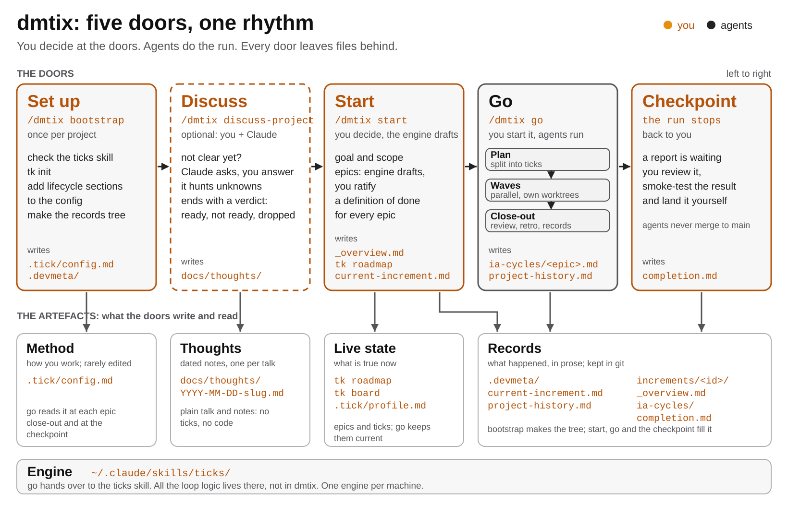

# dmtix — devmeta-on-ticks

## Overview

dmtix is a way of working with AI agents, in three steps: **scope** an increment with you,
**run** it on its own while you are away, then **read the records** it leaves in git. It
runs on the **ticks** skill (the engine) and adds only the part where you talk with Claude.

**When not to use it:** for plain tk/tick work (creating ticks, running an epic by hand) use
the [ticks skill](https://github.com/mkelk/skills/tree/master/skills/ticks) directly. Do not
use dmtix for a question whose answer is knowledge, not a feature; use the research-loop
skill. Do not use it for a small change that needs no scoping.

## Commands

Call a door as `/dmtix <argument>`. With no or an unknown argument, dmtix shows the table and asks.

| `/dmtix <arg>` | Cadence | Does |
|---|---|---|
| `bootstrap` | once per project, and again after an engine update | Installs the method into a ticks project: checks the ticks skill resolves, `tk init`, adds the lifecycle sections to `.tick/config.md` (additive, never overwrites), scaffolds `.devmeta/`. On an existing project it is the upgrade check: offers what a newer engine needs, each change shown first. Safe to repeat. |
| `explain` | whenever asked | Says what the method is in this project, what was set up and why, and what is still the generic default. Read-only. |
| `discuss-project` | before `start`, when the project is not clear enough to spec | Claude-led open talk: asks what the project is, looks at the repo, hunts unknowns, and plays the outline back to challenge your intuition. Keeps a dated note in `docs/thoughts/` and ends with a verdict: ready for `start`, not ready, or dropped. No ticks, no code. |
| `start` (or `start-increment-spec`) | once per increment | Interactive scoping: the engine drafts the epics, you ratify them, with checkable definitions of done. Writes the records tree and the tk roadmap. Setup only; it never executes. |
| `go` | per session | Starts **or resumes** the active increment's run. A thin wrapper over the ticks skill. Stops at the project checkpoint. |

**Usual order:** `bootstrap` once, then (when the project is unclear) `discuss-project`,
then `start` for each increment, then `go` (again after any stop) until the checkpoint,
where you review. `explain` any time.

## The picture


*You decide at the two ends. Agents do the middle, in parallel.*

**Scope** (`/dmtix start`): you and Claude agree the goal, what is out, and the epics, each with a
definition of done. **Run** (`/dmtix go`): you start it and walk away. For each epic the run plans
the ticks, works in parallel waves in their own worktrees, and closes the epic with a review, a
retro and records. **Checkpoint**: the run stops, and a completion report waits for you. You
review it, smoke-test it and land it yourself; agents never merge to main. Not clear yet? Start
with `/dmtix discuss-project`. The method lives in `.tick/config.md`, the records in
`.devmeta/increments/`.

The doors, and the files each one writes:



## Set up

```bash
npx skills add mkelk/skills --skill dmtix --skill ticks -g -a claude-code
curl -fsSL https://raw.githubusercontent.com/pengelbrecht/ticks/main/install.sh | sh   # the tk binary
```

Then run `/dmtix bootstrap` in your repository. It checks that the engine and `tk` are there
and shows every change before it writes it.

## Good to know

- **It never merges to `main` or `master`.** The run stops at the checkpoint. Landing is your act.
- **It never starts the next increment on its own.** `start` sets up, `go` runs, and you decide each.
- **Update between increments.** `npx skills update -g` updates dmtix and the engine for every
  project at once. Then `/dmtix start` (or `/dmtix bootstrap`) offers what a newer engine needs,
  each change shown first.
- **Do not install upstream's own `ticks` skill**, and do not run `tk skills install`.
  `/dmtix bootstrap` refuses the first and offers to remove the second.
- **Adapt it locally.** dmtix is generic; the files it writes in your repository
  (`.tick/config.md`, `.devmeta/`) are yours to edit, and updating the skill never overwrites them.

## How it works inside

This page is for people. How the doors work, step by step, is written for Claude in the skill's own files:
[`SKILL.md`](SKILL.md) and [`references/`](references/).
