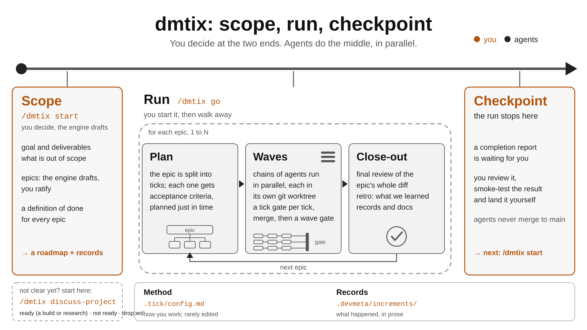

# dmtix — devmeta-on-ticks

## Overview

dmtix is a way of working with AI agents, in three steps: **scope** an increment with you,
**run** it on its own while you are away, then **read the records** it leaves in git. It
runs on the **ticks** skill (the engine) and adds only the part where you talk with Claude.
All the execution logic lives in ticks, not here. `SKILL.md` routes on an argument to one of
five doors in `references/`.

**When not to use it:** for plain tk/tick work (creating ticks, running an epic by hand) use
the [ticks skill](https://github.com/mkelk/skills/tree/master/skills/ticks) directly. Do not
use dmtix for a question whose answer is knowledge, not a feature; use the research-loop
skill. Do not use it for a small change that needs no scoping.

## Commands

Call a door as `/dmtix <argument>`. With no or an unknown argument, dmtix shows the table and asks.

| `/dmtix <arg>` | Cadence | Does |
|---|---|---|
| `bootstrap` | once per project, and again after an engine update | Installs the method into a ticks project: checks the ticks skill resolves, `tk init`, adds the lifecycle sections to `.tick/config.md` (additive, never overwrites), scaffolds `.devmeta/`. On an existing project it is the upgrade check: offers what a newer engine needs, each change shown first. Safe to repeat. |
| `explain` | whenever asked | Says what the method is in this project, what was set up and why, and what is still the generic default. Read-only. |
| `discuss-project` | before `start`, when the project is not clear enough to spec | Claude-led open talk: asks what the project is, looks at the repo, hunts unknowns, and plays the outline back to challenge your intuition. Keeps a dated note in `docs/thoughts/` and ends with a verdict: ready for `start`, not ready, or dropped. No ticks, no code. |
| `start` (or `start-increment-spec`) | once per increment | Interactive scoping: the engine drafts the epics, you ratify them, with checkable definitions of done. Writes the records tree and the tk roadmap. Setup only; it never executes. |
| `go` | per session | Starts **or resumes** the active increment's run. A thin wrapper over the ticks skill. Stops at the project checkpoint. |

**Usual order:** `bootstrap` once, then (when the project is unclear) `discuss-project`,
then `start` for each increment, then `go` (again after any stop) until the checkpoint,
where you review. `explain` any time.

## The picture



*You decide at the two ends. Agents do the middle, in parallel.*

**Scope** (`/dmtix start`): you and Claude agree the goal, what is out, and the epics, each with a
definition of done. **Run** (`/dmtix go`): you start it and walk away. For each epic the run plans
the ticks, works in parallel waves in their own worktrees, and closes the epic with a review, a
retro and records. **Checkpoint**: the run stops, and a completion report waits for you. You
review it, smoke-test it and land it yourself; agents never merge to main. Not clear yet? Start
with `/dmtix discuss-project`. The method lives in `.tick/config.md`, the records in
`.devmeta/increments/`.

## Fuller documentation

### Dependency: the ticks engine

dmtix is the *method*; it runs on the *ticks* skill (the *engine*), which lives in this repo
at [`skills/ticks/`](https://github.com/mkelk/skills/tree/master/skills/ticks). Install both:

```bash
npx skills add mkelk/skills --skill dmtix --skill ticks -g -a claude-code
```

The engine is installed at user level (`~/.claude/skills/ticks/`); `/dmtix bootstrap` checks
for it and tells you if it's missing. Claude Code resolves same-name skills *personal over
project*, so a project's own `.claude/skills/ticks/` never runs while the user-level one is
installed, and a project can't be held on another engine version. The engine began as a skill
by Peter Engelbrecht (`pengelbrecht/ticks`, MIT licence; see
[`LICENSE`](https://github.com/mkelk/skills/blob/master/skills/ticks/LICENSE)).

Two sources, two jobs: the **`tk` binary** comes from upstream `pengelbrecht/ticks`
(version 0.19 or later), the **skill** from this repo. Install the binary with:

```bash
curl -fsSL https://raw.githubusercontent.com/pengelbrecht/ticks/main/install.sh | sh
```

Do not install upstream's own `ticks` skill. Do not run `tk skills install` either. Upstream's
skill only tracks work and has no run loop. The command writes it into the project's
`.claude/skills/ticks/`, where it runs if the engine is not installed at user level. If the
engine is installed, it only confuses things. `/dmtix bootstrap` refuses the first and offers
to remove the second.

### Upgrading

```bash
npx skills update -g          # the engine (ticks) and dmtix, at user level
```

Then run `/dmtix bootstrap` in each project, or just start its next increment: `/dmtix start`
runs the same upgrade check. Nothing needs migrating by hand and nothing breaks if you skip
it. The check offers what would otherwise stay on the old behaviour — split an over-budget
learnings file, group `## Testing` under the two gates, remove a leftover project copy of the
engine — each shown in full before it is written, never during a run.

**One engine per machine, so update between increments.** The engine is user-level, so
`npx skills update -g` changes it for every project at once, and no project copy can hold one
back. Running sessions pick the change up without a restart: Claude Code reloads a changed
`SKILL.md`, and the engine reads its `references/` from disk each time it uses them. An
orchestrator mid-epic finishes on the text it already loaded. The engine is written so an
increment started on an earlier version continues safely; if one must not see the change at
all, update after it reaches its checkpoint.

### Set-up in a repository

dmtix is generic; each project adapts it locally. The files below are the project's own: you
may and should edit them, and updating the skill never overwrites them.

Where things live (separation of concerns):

- **Method** (edit only to change how you work): `.tick/config.md`
- **Live state**: tk (`tk roadmap`, `tk board`); inferred execution facts: `.tick/profile.md`
- **Narrative records** (written by the run at each boundary): `.devmeta/increments/increment-<NN>-<xxx>/`
  (`_overview.md`, `ia-cycles/`, `completion.md`) + `.devmeta/project-history.md`
- **Engine**: the ticks skill, user-level (`~/.claude/skills/ticks/`)

#### Files written

| File | Written by | Committed? |
|---|---|---|
| `.tick/config.md` (lifecycle sections) | `bootstrap` | when you accept its offer to commit |
| `.tick/` (ticks, roadmap) | `bootstrap`, `start`, `go` | yes |
| `.devmeta/` scaffold, `current-increment.md` | `bootstrap`, `start` | when you accept its offer to commit (`start` commits them) |
| `.devmeta/increments/increment-<NN>-<xxx>/_overview.md` | `start` | yes (`start` commits `.devmeta/` and `.tick/`) |
| `.../ia-cycles/` (made by `start`; the run fills it), `completion.md`, `.devmeta/project-history.md` | `go` (the run) | yes, as the run commits at its boundaries |
| `docs/thoughts/YYYY-MM-DD-<slug>.md` | `discuss-project` | yes (committed when the verdict is set) |
| branch `YYYY-MM-DD-<slug>` | `start`, if you choose a new base branch | a branch, not a file |
| git tag `<ID>.<epic-slug>` | the run, at each epic close-out | a tag |
| `.tick/learnings*.md` | the run | yes |

`.tick/profile.md` is inferred by the engine from the repo.

#### What it never does

- It never merges to `main` or `master`. Integration ends at the increment's base branch;
  landing is your act. The run works on an increment branch, never on main.
- `start` never executes and never plans epic internals. Setup ends there.
- `go` never edits `.tick/config.md`; it only reads it. Method changes are made by you.
- `bootstrap` never overwrites existing files or config sections without your yes, and shows each change first.
- `discuss-project` never creates ticks, touches `.tick/` or `.devmeta/`, or writes code.
- It never starts the next increment on its own.

#### References

[`references/bootstrap.md`](references/bootstrap.md) ·
[`references/discuss-project.md`](references/discuss-project.md) ·
[`references/start-increment-spec.md`](references/start-increment-spec.md) ·
[`references/go.md`](references/go.md)
