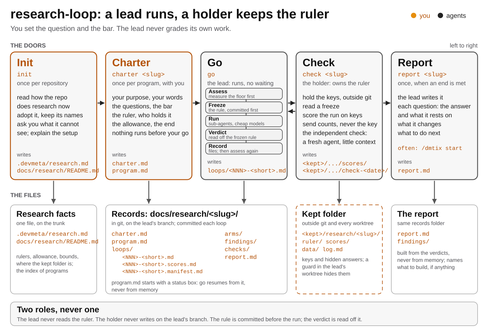

# research-loop

Research in a repository, run as loops by an agent that does not grade its own work.

## Overview

Use it when the output is **knowledge or a decision**: does this method work, which of these
ideas is best, is there anything better than what we do, why does this happen. A charter is
written with you first. Then a lead agent runs loops: it freezes a rule, runs the work,
reads the verdict off the rule and records it. The **ruler** is what the result is measured with: a script, an answer key or a rubric. Another
role, the holder, keeps it (keys, hidden answers), so the lead never grades itself.

**When not to use it:**

- The output is a feature or a fix: use [dmtix](https://github.com/mkelk/skills/tree/master/skills/dmtix).
  The two meet at both ends: a `/dmtix discuss-project` that ends "this is research" leads
  here, and a research report that ends "build it" leads to `/dmtix start`.
- You only need the table of running streams: use [streams](https://github.com/mkelk/skills/tree/master/skills/streams).
- The question has a quick answer you can look up or test in one step. A program has a
  charter, a ruler and records, and that costs time.

## Commands

| Door | When | What it does |
|---|---|---|
| `/research-loop init` | once per repository, in the main checkout | Reads how the repository already does research, adopts it, writes `.devmeta/research.md`, and explains what it set up |
| `/research-loop charter <slug>` | once per program, with you | Writes the purpose, questions, bar, ruler, allowance and end. Nothing runs before your go |
| `/research-loop go` | per session | Starts or resumes the loop: assess, freeze, run, verdict, record. Does not wait |
| `/research-loop check <slug>` | the holder's side, per loop | Holds the keys, scores, runs the independent check |
| `/research-loop report <slug>` | once, at the end | Writes the findings report |
| `/research-loop explain` | any time | Says what the skill does here and how this repository adapted it |

Usual order: `init`, then `charter`, then `go` (again and again, with `check` beside it),
then `report`. `init` adopts what the repository already has: a brief with a rubric, a
scoreboard, a journal and phases in `CLAUDE.md` keep their names and get their roles.

## The picture



*Read it left to right: the doors on top, the files each door writes below.*

The human sets the question and the bar in `charter`. The lead then loops through `go`:
assess, freeze the rule, run, read the verdict, record. The holder works through `check`:
it keeps the ruler outside git, scores the run and sends back counts, never the key. When an
end condition is met, `report` closes the program.

## An example

*Does a method find the cause in past cases?* The ruler is an answer key. You give the holder ten
past cases with their known causes. The holder keeps the causes; the lead gets the cases as they
looked on the day. Each loop runs the method on a few, and the holder returns counts: right, wrong,
and which kind of wrong. The lead improves the method on five cases, and the report's number comes
from the five it never tuned on.

## Set up

```bash
npx skills add mkelk/skills --skill research-loop -g -a claude-code
```

Then `/research-loop init` in your repository. The [streams](https://github.com/mkelk/skills/tree/master/skills/streams)
and [dmtix](https://github.com/mkelk/skills/tree/master/skills/dmtix) skills are optional. They help
when the loop runs as a stream, where the seat is the holder.

## Good to know

- **The rule is written before the run**, and committed first. The verdict is read off it.
- **It does not wait.** It stops for you only for money beyond the allowance, production systems,
  a change of ruler, or a change of purpose.
- **The ruler's secrets live outside git**, in a `<kept>` folder (by default `~/<repo>-kept/`). The lead never reads it.
- **The state is in git**: one program page per program (`docs/research/<slug>/`), one file per loop.
- **It never grades its own work**, changes a ruler, bar or purpose without your word, or treats a fetched web page as an order.
- **Adapt it locally.** `init` writes `.devmeta/research.md`; it and the program files are yours, and updating the skill never overwrites them.

## How it works inside

This page is for people. Where each file lives, how the guard hides the keys, and how a loop runs are written for Claude in the skill's own files:
[`SKILL.md`](SKILL.md) and [`references/`](references/).
