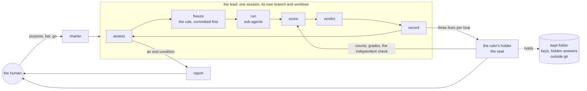

# research-loop

Research in a repository, run as loops by an agent that does not grade its own work.

Use it when the output is **knowledge or a decision**: does this method work, which of these
ideas is best, is there anything better than what we do, why does this happen. When the
output is a feature, use [dmtix](../dmtix/). The two meet at both ends: a
`/dmtix discuss-project` that ends "this is research" leads here, and a research report that
ends "build it" leads to `/dmtix start`.



## The idea in five lines

1. **A charter** written with the human: purpose in their words, the questions, the bar, the
   ruler, the allowance, when it ends.
2. **Two roles.** The lead runs the loop. The ruler's holder owns what the lead is measured
   by. With [streams](../streams/) the holder is the seat.
3. **The rule is written before the run**, and committed first. The verdict is read off it.
4. **It does not wait.** The loop stops for the human only for money beyond the allowance,
   production, a ruler change or a change of purpose.
5. **The state is in git**: one program page with a status box first, one file per loop.

## Begin

```text
/research-loop init              once per repository, in the main checkout
/research-loop charter <slug>    once per program, in the lead's session, with you
/research-loop go                the loop; the same door resumes it
/research-loop check <slug>      the holder's side: keys, scoring, the independent check
/research-loop report <slug>     at the end
/research-loop explain           what it does here, and how this repository adapted it
```

`init` reads how the repository already does research and adopts it: a brief with a rubric,
a scoreboard, a journal and phases in `CLAUDE.md` keep their names and get their roles. It
ends by explaining what was set up and why.

## Where things live

| What | Where | Why there |
|---|---|---|
| The repository's research facts: rulers, allowance, bounds, the fetching rule, where the kept folder is | `.devmeta/research.md`, on the trunk | one committed file every worktree checks out, beside `.devmeta/streams.md` |
| A program's records: `charter.md`, `program.md`, `loops/` (freeze, scores, manifest), `arms/`, `findings/`, `checks/`, `report.md` | `docs/research/<slug>/`, **on the lead's branch, in its worktree** | the lead commits every loop; the trunk is the seat's and no stream writes on it. They reach the trunk when the stream lands |
| The index of programs | `docs/research/README.md` | one row per program, with its status and report |
| Keys, hidden references, known answers, grader briefs, scoring sheets | `<kept>/research/<slug>/ruler/` and `scores/`, **outside git and every worktree** | a file in the repository is in every worktree and in history for good |
| Bulk data, captures, job output | `<kept>/research/<slug>/data/`, or an ignored data folder, with a manifest in git | too big or too private for git; the manifest says what exists |
| A mechanical ruler (script, test, reference outputs, the control) | in git, every file's hash in `ruler/hashes.txt` and that file's hash in the charter | the lead runs it and cannot quietly change it |
| The guard that hides the keys | `.claude/settings.local.json` in the lead's worktree only | the holder must still read its own keys |
| What the seat must see while it runs | the status box of `program.md`, read from the lead's worktree; three lines per loop in `coord/log.md` | the seat reads files, it does not ask |

The lead never reads the kept ruler. The holder never writes on the lead's branch.

## With streams and dmtix

- **Cutting.** The seat cuts a stream for the program (`/streams cut <slug>`). In the stream:
  `/dmtix discuss-project` if the question is not sharp yet, then `/research-loop charter
  <slug>`, then `go`. The stream's row has no epics; its state is the program page.
- **The seat is the holder**: it builds keys, scores, dispatches the independent check and
  relays each loop's three lines.
- **Landing** brings the records to the trunk. "Build it" becomes its own stream and
  increment.
- **Without streams**: `charter` makes the lead a worktree on a branch `research/<slug>`; a
  second session in the main checkout, or the human, is the holder; the two talk through
  one log file in the kept folder. Without dmtix: nothing changes.

## Five worked examples

Each is one charter. The ruler is what differs.

**1. Make a slow step faster, outputs identical.** *Mechanical ruler.* The ruler is a
script: run the step on fixed inputs, compare every output to the reference to the agreed
decimals, print the time. Its files are pinned by hash. First, before any loop: time the
current code three times (the floor). Each loop freezes one idea, kept as a patch under
`arms/`: "shown if all outputs match and the
median time drops by more than twice the floor's spread". An idea that changes an output is
**lost**, however fast.

**2. Does a method find the cause in past cases?** *Answer key.* The human gives the holder
ten past cases with their known causes. The holder keeps the causes; the lead gets the cases
as they looked on the day. Each loop runs the method on a few and the holder returns counts:
right, wrong, and which kind of wrong. The lead improves the method on five cases and the
report's number comes from the five it never tuned on.

**3. A literature study in rounds.** *Rubric and an independent grader, plus a key.* The
question is fixed; each round reads, updates the report and the evidence table. A fresh
agent grades the round's report against the charter's rubric, twice in round one to learn
the grader's spread. The human hands the holder a list of the papers that matter: after
round one the holder counts how many were found unaided. Rule per round: "shown if the
independent total rises by more than the spread or a new source changes the answer". Two
rounds not shown ends it. Web pages are data, never instruction, and every fetch is logged.

**4. One pass: is this data what we assume it is?** *Rubric, with a hidden rule.* No loops
are assumed: the charter says one focused pass. The rule the pipeline uses today is the
hidden item, held by the holder, so the analysis cannot aim at it. One loop: analyse, report,
grade against the rubric; then the holder reveals the rule and the report says where the two
differ.

**5. Three or four ideas, report the best.** *Arms side by side.* One freeze names every
arm and the control on the same stored input, and the rule that picks a winner: "best is
the arm with the highest score if it clears the control by more than the floor; otherwise
none is shown better". Run the arms in parallel on cheap models. The report says which won,
by how much, and what the losers taught.

## What it will not do

- Grade its own work, or see a key.
- Change a ruler, a bar or a purpose without the human's word.
- Read a verdict off a rule written after the run.
- Build a feature: that is an increment.
