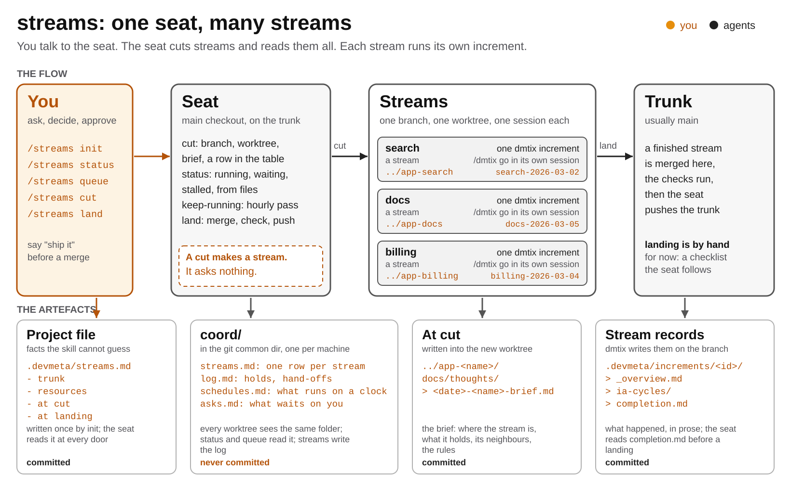

# streams

Run several pieces of work on one repository at the same time, each in its own worktree, with
one session that sees them all.

## Overview

One session doing one increment at a time is slow. Several sessions on one checkout step on each
other. **streams** gives each piece of work its own branch, worktree and resources, and keeps
the facts they share in files every worktree can read. One session, the **seat**, sees them all:
it cuts streams, reads their state, tells you what waits on you, and lands a finished stream.

**When not to use it.** For one piece of work at a time, use [dmtix](https://github.com/mkelk/skills/tree/master/skills/dmtix) alone. The sessions that run a stream do
not use this skill; they run `/dmtix go`. It is not for a plan above several increments or for a
research program; other skills cover those.

## Commands

| You type | It does | Reference |
|---|---|---|
| `/streams init` | writes the project file, creates `coord/` | [init.md](references/init.md) |
| `/streams status` | one screen: running, waiting on you, stalled | [status.md](references/status.md) |
| `/streams keep-running` | the hourly pass: look, then act | [keep-running.md](references/keep-running.md), [scout.md](references/scout.md) |
| `/streams queue` | the list of what waits on you, with what to type | [queue.md](references/queue.md) |
| `/streams cut <name>` | a new stream: branch, worktree, resources, records, brief | [cut.md](references/cut.md) |
| `/streams compact` | keeps long sessions' context small | [compact.md](references/compact.md) |
| `/streams restart` | brings back what ran on a clock after a stop | [restart.md](references/restart.md) |
| `/streams hotfix <name>` | one stream's fix to the trunk, the stream keeps running | [hotfix.md](references/hotfix.md) |
| `/streams land <name>` | a finished stream onto the trunk (a checklist for now) | [land.md](references/land.md) |

The usual order: `init` once, then `status` and `queue` as you work, `cut` for each new stream, `land` when one is finished. `keep-running`, `compact` and `restart` run by the clock or after a stop.

Worked recipes for heavy runs: [references/recipes/](references/recipes/). The rules every door
follows, and why each exists: [SKILL.md](SKILL.md).


## The picture



*Read it top to bottom: the flow (you, the seat, the streams, the trunk) on top, the files below.*

You ask and decide; the seat cuts streams and reads them all. Each stream is one branch in one
worktree with its own session, running its own increment. A finished stream is merged into the
trunk by the seat. The files below the flow are the project file (committed), `coord/` (shared
by every worktree, never committed) and what a cut writes into the new worktree.

## Fuller documentation

Committed: `.devmeta/streams.md`, and the brief a cut writes. Never committed: `coord/`, in git's common directory. The seat never writes code on a stream's branch, never merges into a running stream's branch, and pushes only the trunk. The rules behind every door: [SKILL.md](SKILL.md).

### What the words mean

- **The trunk** is the branch every stream lands on, usually `main`
  (`coord.py config --get trunk` prints it).
- **A stream** is one piece of planned work (a dmtix increment) on its own branch, in its own
  git worktree, driven by its own Claude session. It holds its own share of anything two
  streams may not share, such as a block of ports. Inside it, [dmtix](https://github.com/mkelk/skills/tree/master/skills/dmtix) splits the
  increment into **epics** (one stage each) and each epic into **ticks** (one task each, run by
  an implementer agent in its own worktree, several at once in a **wave**); a **checkpoint** is where a stream stops for the
  human.
- **The seat** is the one session that sees every stream. It sits in the main checkout, talks to
  you, cuts new streams, reads their state, relays what one stream found that another needs, and
  lands a stream when it is done. It never writes code on a stream's branch.
- **`coord/`** is a folder inside git's common directory (`git rev-parse --git-common-dir`).
  Every worktree of the repository sees the same folder at once, and git never tracks it. It
  holds `streams.md` (the running streams, one row each), `log.md` (one dated line per hold,
  deploy, hand-off or debt), `schedules.md` (everything that runs on a clock, and how to restart
  it) and `asks.md` (what waits on you).
- **The project file** `.devmeta/streams.md` is committed. It holds the facts about your project
  that the skill cannot guess: the trunk, where worktrees go, what a fresh worktree needs, what a
  landing must run.

### Set up and first steps

1. **Install.** The skill builds on the `dmtix` method and its `ticks` engine, so install all
   three, and the `tk` tracker binary they use (see the [repo README](https://github.com/mkelk/skills#install)):

   ```bash
   npx skills add mkelk/skills --skill streams --skill dmtix --skill ticks -g -a claude-code
   ```

   `-g` installs for every project; see the repo README's Install section for when not to.

2. **`/streams init`**, once, in the main checkout on the trunk. It detects the trunk, the
   package manager and the test runner, asks you two questions (what may two streams not share,
   and where worktrees should go), writes `.devmeta/streams.md` and creates `coord/`.
3. **`/streams status`** whenever you want to know what is running, what waits on you and what
   has stalled. It reads files and processes, never the sessions' own reports.
4. **`/streams cut <name>`** to start a new stream. The name is one short lowercase word, and it
   leads every label the stream carries.

Each stream's own session then runs `/dmtix go`. The seat does not run increments.

### Good to know

- **Where the session opens.** The stream's session opens in the herdr window also when the
  window runs on another machine (Windows with herdr-core inside WSL, or over ssh). The space is
  named after the worktree's folder (`<repo>-<slug>`), not after the stream.
- **The first cut.** In a repository with no mainline row yet, the first cut asks: "side stream
  or mainline?" Do not leave it to a default.
- **Claude Code 2.1.331 or later.** 2.1.325 reported no status to herdr, so the seat's text
  was typed into a trust question.
- **A trust question.** A session in a folder Claude Code does not trust yet stops at its trust
  question. You answer it in that pane, never the seat.
- **Adapt it locally.** The skill is generic; each project adapts it. `.devmeta/streams.md` and
  the project's `coord/` files are the project's own: edit them. Updating the skill never
  overwrites them.

### Seven examples

All names, ports and times below are invented. The repository is `/src/app`, so worktrees sit
beside it as `../app-<name>`; the stack is Python with `uv` and `pytest`.

#### 1. A day with three streams: the status screen

```text
> /streams status

STREAMS · 2026-03-05 14:10

NEEDS YOU
  k2v   search   DO approve or reword the empty-result message
                 · WHERE ../app-search/docs/ui/empty-state.png
                 · CLOSES WHEN your words are in the close reason

STALLED / UNKNOWN DRIVER
  docs   idle 95 min, 2 ticks left, no commit since 12:31

STREAM    SESSION   STATE     EPICS   ~%   AT              IN FLIGHT              LAST    WHAT NOW              RESOURCES
search    search    idle      ●●◑○    62   E3 of 4 · 3/6   clean                  9m      waits on you (k2v)    api 8000 · staging
billing   billing   working   ●◔○     38   E2 of 3 · 1/5   2 implementers, 140    2m      a wave running        api 8010
docs      docs      idle      ◑       25   E1 of 1 · 2/4   clean                  1h39m   idle, 2 ticks left    —

HEAVY RUNS  free

HOLDS
  staging  13:52   until 14:32, 22 min left   billing

OWED
  a3   docs   1h10m   which page layout to keep

SCHEDULES
  seat     hourly pass · :05 each hour
  billing  nightly import test · 02:00
  after the terminal server or Claude stops: /streams restart (each row says how)

LOG  (the newest lines of coord/log.md)
  2026-03-05 13:52 UTC billing: HOLD staging: schema migration test until 2026-03-05 14:32 UTC
  2026-03-05 13:40 UTC search: READY E3 checkpoint, k2v waits on the human
```

One glyph per epic: `●` done, `◑` half way, `○` not started. `~%` is a rough share of the whole
increment. See [references/status.md](references/status.md).

#### 2. A cut, from the ask to the brief

```text
> we need a stream for the docs site rewrite, beside search and billing

> /streams cut docs --scope "#41"

Side stream or mainline? The table has a mainline row (search), so no question: side stream.
Claimed: api 8020 and redis db 2 (k=2, lowest free).
Worktree ../app-docs on docs-2026-03-05, from search-2026-03-02 at 4f1c2aa.
At cut: uv sync --frozen ✓  cp .env.example .env ✓  API_PORT=8020 ✓
Records: the trunk's list of running increments names 07s2-ghi, issue #41 claimed, row added to coord/streams.md (read back).
Brief: docs/thoughts/2026-03-05-docs-brief.md, committed.

Stream 07s2-ghi cut. Open a terminal:
  cd ../app-docs
  claude
then: /dmtix start with the id 07s2-ghi given by hand
The brief is docs/thoughts/2026-03-05-docs-brief.md; tell the session to read it first.
```

The brief tells the new session where it is, what it holds and what it does not (no deploy host),
who its neighbours are and which files they own, and the project's standing rules. Say *"start
it yourself"* and the seat opens the session through `term.py` (example 7) instead.
See [references/cut.md](references/cut.md).

#### 3. A hold with an end, and its release

Hold only what cannot be shared: a run that **writes** to one shared thing. Every hold has an
end, so a forgotten one shows up instead of blocking the machine for good.

```text
$ coord.py log "HOLD staging: schema migration test" --for 40m --as billing
2026-03-05 13:52 UTC billing: HOLD staging: schema migration test until 2026-03-05 14:32 UTC

$ coord.py log "HOLD staging: quick check"
coord log: A hold needs an end. Add --for 40m (a length) or --until 07:30 (the human's local time).

$ coord.py show --holds
HOLDS
  staging  by billing since 13:52, until 14:32 (17m left): HOLD staging: schema migration test …

$ coord.py log "RELEASE staging" --as billing
2026-03-05 14:21 UTC billing: RELEASE staging
```

A hold past its end prints under EXPIRED HOLDS and under NEEDS YOU in `status`: release it, or
hold it again with a new end. A debt works the same way: `OWED <stream>: <what>` prints an id
(`a3`), and `PAID a3` closes it. `coord.py` is `python3 <skill dir>/scripts/coord.py`.

#### 4. A landing

```text
search: READY at 9be20d1 — last stage closed, its completion report written, k2v closed by the human.

> /streams land search
1  quiet point: no task running, checkout clean, no heavy run (pgrep), worktrees match the rows
2  done: the stream says it is finished, its completion report is there, its notes to the seat read
2b your sign-off first: "ship it" recorded on the branch, before the merge
3  merge search-2026-03-02 into the trunk, in the main checkout
4  files both sides changed, merged by the project's rules (the diary keeps both, in date order)
5  the stream's own landing step: the one line it asked for, named in the merge message
6  the checks on the merged tree: uv run pytest ✓  (one run over this and billing's last landing)
7  is-ancestor 9be20d1 origin/main ✓; the trunk's records say what shipped ✓
8  pushed main 3d70e55; worktree and branch removed; row moved to .devmeta/streams.md as landed
9  close the "search" session now; billing and docs: the trunk moved, sync when it suits you
```

Landing is still a checklist the seat follows by hand: [references/land.md](references/land.md).
The seat merges into the trunk and pushes only the trunk. It never merges into a running
stream's branch; it tells the stream the trunk moved.

#### 5. The hourly pass (scout)

`/streams keep-running` runs on a timer, hourly. A small, cheap subagent does the looking, so the
seat's context keeps only a short report. The seat then acts and tells you only what needs you.

```text
SCOUT 15:05 UTC
FOR THE SEAT
- docs: idle 1h50m after "back in 20 min" at 13:15 — evidence: log 13:15, no line since
  — suggest: ask docs what it waits on
- search: "rerun after 14:00" at 13:40, no line since — evidence: log 13:40 — suggest: ask search
FOR THE HUMAN
- search: READY since 13:40, landing waits on your close of k2v — evidence: asks.md q4
QUIET
- billing: working, second batch of tasks in its second stage, 2 implementers
```

The seat confirms one fact before acting on each line (a scout is a lead, not a measurement),
messages docs and search, and tells you one line: *"search is ready to land; q4 needs your
close."* See [references/keep-running.md](references/keep-running.md) and
[references/scout.md](references/scout.md).

#### 6. The project file

`/streams init` writes the first four sections from what it detected and what you answered. Add
`## Heavy runs` by hand when the project has a run too heavy for two at once.

```markdown
# Streams — this project's facts

## Project

trunk: main

## Resources

api port: 8000 + 10×k
redis db: k
staging: one at a time, held with a coord HOLD

## At cut

uv sync --frozen
cp .env.example .env

## At landing

uv run ruff check
uv run pytest

## Heavy runs

- Integration tier (containers): `pgrep -f "pytest -m integratio[n]"`; one at a time.
```

`k` is the stream's number: stream 1 gets api port 8010 and redis db 1. With no `worktree root:`,
worktrees go beside the main checkout. Check what the doors will read:

```text
$ coord.py config --slug docs
project file: /src/app/.devmeta/streams.md
trunk: main  (file: .devmeta/streams.md → ## Project, trunk:)
worktree_root: /src  (detected: the main checkout's parent directory)
at_cut:  (file: .devmeta/streams.md → ## At cut)
    uv sync --frozen
    cp .env.example .env
at_landing:  (file: .devmeta/streams.md → ## At landing)
    uv run ruff check
    uv run pytest
worktree: /src/app-docs
resources:
    api port: 8000 + 10×k
    redis db: k
    staging: one at a time, held with a coord HOLD
sections: ## Heavy runs
```

See [references/init.md](references/init.md). Worked heavy-run rules (a browser UI tier, for one)
live in [references/recipes/](references/recipes/).

#### 7. The terminal adapter

The seat finds each stream's session by asking the terminal server, not by remembering a name.
`term.py` is the only file that talks to it, and the one place to adapt for another server. It
tries [herdr-core](https://github.com/herdrdev/herdr-core) (`hc`, the server behind the
[herdr-app](https://github.com/herdrdev/herdr-app) window) first and
[herdr](https://github.com/herdrdev/herdr) as the fallback, so moving sessions from one to the
other changes nothing else. The skill works without either: you open the sessions yourself.

```text
$ term.py which
hc

$ term.py ls
hc    t1           idle     claude   seat                     /src/app
hc    t4           idle     claude   search                   /src/app-search
hc    t5           working  claude   billing                  /src/app-billing
hc    t7           idle     claude   docs                     /src/app-docs

$ term.py read t7 --lines 15        # what the docs session shows
$ term.py send t7 'the trunk moved to 3d70e55; sync when it suits you'
```

The `cwd` column maps a worktree to its session without asking anyone. The state is `working`,
`idle`, `blocked` (waiting on a prompt in its pane) or `unknown`. With `--json`, each session
carries `server`, `id`, `cwd`, `foreground_cwd`, `label`, `agent`, `state`, the server's own word
as `status`, and the agent's `session` id. When neither server answers,
`term.py` exits 2 and the seat falls back to printing what you should open.

### Limits

- `coord/` is per machine. Anything another machine must see goes to your issue tracker.
- The seat is a session; it may be asleep. Anything that must happen without it needs a guard
  or a schedule, not the seat's memory.
- Landing is not automatic yet. The seat follows the checklist by hand until two landings
  confirm every step.
