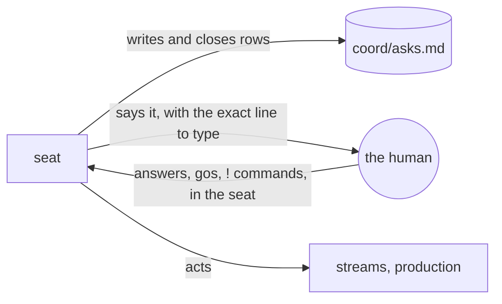

# queue — the list of what waits on the human

*The human, 2026-11-03: a herdr pane "called queue that keeps track of stuff I need to do right
now — it tends to get swamped in seat's dialogue with me and seat's statuses".* The list kept;
the pane did not. **The human, 2026-11-05:** *"A good idea that seat keeps track of it in a file
- but the separate herdr pane queue does not really work. So keep the accounting and seat's
ability to register/track, but drop the queue tab and its responsibilities."* Since then the
seat alone keeps the list and talks to the human about it.

**The seat alone holds the list, because a second session holding it did not work.** From
2026-11-03 to 2026-11-05 a separate pane beside the seat, a Claude session on a cheaper model
named `queue`, read `asks.md`, showed the human only that, logged their answers word for word as
`ANSWER q<n>: <their exact words>` lines in `coord/log.md`, and messaged the seat. A go typed
there counted, but only through that log line, and the seat acted on the line, never on the
pane's summary of it. It was dropped after two days, in the human's words above because the
pane "does not really work"; the file and the seat's accounting were the part worth keeping,
and with the pane gone a go again counts only where the human types it to the seat.

## What it is

- **`<git common dir>/coord/asks.md`** — one row per thing only the human can do or decide:
  an id (`q1`, `q2`, … never reused), what it is in plain words, the exact thing to type (a `!`
  command, or `say: …` for a decision), who waits on it, since when (UTC). Sections **Now**,
  **Optional, no deadline**, **Later** (with when), **Done** (with the answer). Never committed.
  `scripts/coord.py init` creates it.
- **Every row gets a why**, in the file's **Why** section: what it is in plain words, what each
  answer does, and what happens if nothing is decided. When the human asks about a row, answer
  from it.

## The seat's half (every door, every pass)

- **Something now waits on the human → a row, the same turn.** A go the seat asks for, a `!`
  command they must run, a decision, a checkpoint a stream reached. Give the exact line to
  type. Say it to them in the seat as well; the row is what survives the scroll.
- **They answer in the seat → act, then move the row to Done** with their words.
- **A command they ran → close the row, and add the next one** (an approve line follows a
  propose). Check the result on the thing (the project's own read of it, the settings file),
  not the report.
- **`keep-running` checks the list** every pass: a row that no longer waits on anything (close
  it); something waiting on the human with no row (add it). A **Later** row whose time has come
  moves to **Now**. When they ask "what waits on me", the answer is the **Now** rows, each with
  its line.
- Edit `asks.md` the way every coord file is edited: copy it to the session scratchpad first,
  then an exact-match replace, never by line number, and read the change back.

## Where a go counts

A go counts only typed by the human in the seat (an AskUserQuestion answer there counts). The
queue pane's `ANSWER q<n>` log lines from 2026-11-03 to 2026-11-05 stay in `coord/log.md` as
history; no new ones are written, and no other session's message carries a go.
