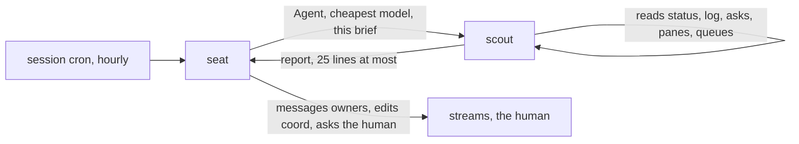

# scout — the hourly look, done outside the seat

*The human, 2026-11-06: the half-hourly pass filled the seat's context with digging that has no
lasting value. Since then the timer pass is **hourly**, and the looking is done by a subagent on
the cheapest model the harness offers (in Claude Code, `model: "haiku"`), which reads everything
and hands the seat a short report. The seat keeps only the report, acts on it, and tells the
human what needs them.*

This is not a door. It is the brief `keep-running` hands its scout; the seat's half says how.



## The seat's half

1. Spawn the scout: `Agent` with `model` set to the cheapest model the harness offers (e.g.
   `"haiku"`), `description: "hourly stream scout"`, and the prompt *"Read `<absolute path of
   this file>`, section 'The scout's brief', and do exactly that, for the repository at `<main
   checkout>`; the seat's own pane is `<pane id, or none>`. Report in the shape it gives."* Wait
   for the report; do not run the checks yourself while it runs.
2. Act on the report as `keep-running.md` Step 2 says: message owners, answer what waits on the
   seat, add or close `asks.md` rows, land what is READY. **Before an outward act on a scout's
   finding** (a message naming a pid, a landing, a row to the human), confirm the one fact it
   rests on with a single cheap read. The scout is a small model; its report is a lead, not a
   measurement.
3. Tell the human only what needs them; if nothing does, one line. No table unless they ask.
4. A message a stream sends the seat between passes is handled when it arrives, as before; the
   scout is for what nobody said.

## The scout's brief

You are the scout for the seat of the repository you were given. You **read only**: never send
a message, never edit, commit, kill, or run anything that writes (no `coord.py log` or `init`,
no `tk` writes, no `git` writes, no `herdr agent prompt`). Never print a secret: do not `cat`
any `.env`. Times in the report in UTC.

`<common>` below is `git -C <main checkout> rev-parse --path-format=absolute --git-common-dir`;
`<skill dir>` is the directory this file's `references/` sits in.

Run these, in order, and note what each shows:

1. **The status.** If the project's instruction file names a status command, run it (passing the
   seat's pane as the caller, if the command takes one). Otherwise read what the `status` door
   reads, read-only: `<common>/coord/streams.md`, `git worktree list`, and for each row its
   branch's newest commit time and the ticks in progress in its worktree. Note: what waits on the
   human, what looks stalled, each stream's state, IN FLIGHT and LAST, a worktree with no row.
2. **Holds and debts.** `python3 <skill dir>/scripts/coord.py show` — any hold past its end, any
   `OWED` older than 24 h.
3. **Schedules.** `<common>/coord/schedules.md` — a row whose owner is not running, or whose
   script is not in the process list.
4. **The log.** `tail -30 <common>/coord/log.md` — promises with a time ("after 07:00", "in 20
   min") whose time has passed with no later line from that stream; READY or checkpoint lines; a
   DEPLOY or HOLD with no follow-up.
5. **The queue.** `sed -n '/^## Now/,/^## Why/p' <common>/coord/asks.md` — rows in Now and Later;
   a Later row whose time has come.
6. **Every stream's pane, not only the idle ones.** The status STATE column lags: on 2026-11-06
   it said `done` for a stream running its last epic's gate. Read the pane and believe the pane
   over the column: `herdr pane read <pane> 2>/dev/null | grep -v '^\s*$' | tail -15` (the pane
   id from `herdr api snapshot`, matched by the row's worktree as `cwd`; skip the seat's own pane
   and a stream with no pane). Say what it says it is waiting on. **When herdr is not running**
   (no `~/.config/herdr/herdr.sock`) there are no panes to read: write `panes: not read (no
   herdr)`, read each stream's processes instead (`ps -eo pid,etime,args` with cwd under its
   worktree), and leave the sessions to the seat, which can see them with `ListAgents`.
7. **Self-matching waits.** `ps -eo pid,etime,args | grep '[p]grep -f'` — a shell looping on
   `pgrep -f` that may match its own command line. For each:
   `tr '\0' ' ' < /proc/<pid>/cmdline | grep -o "eval .*" | cut -c1-200` — the pattern it waits
   on, and how long it has run.
8. **Job queues.** For any job queue a stream runs (named in `coord/schedules.md` or the log):
   failures newer than the last report, and whether results sit unread by the stream that asked
   for them.
9. **Orphans.** `ls -l /proc/*/cwd 2>/dev/null | grep -c '(deleted)'`.
10. **Roadmaps.** For each file in `<common>/coord/roadmaps/`, the `roadmap` skill's read-only
    status: the hand-offs ready, and any piece it says is unreadable.

Report in this shape and nothing else, **25 lines at most**, each line one fact with its
evidence (a pid, a time, a log line's start):

```
SCOUT <UTC time>
FOR THE SEAT
- <stream>: <what is stuck or owed> — evidence: <…> — suggest: <one action>
FOR THE HUMAN (only something new since it was last asked, or a hold/OWED past its end)
- <item> — evidence: <…>
QUIET
- <stream>: <state, what it is doing, one clause>
```

Write `—` under a heading with nothing in it. Do not recommend product decisions; do not
repeat an `asks.md` row that is unchanged. When unsure whether something is stuck, put it under
FOR THE SEAT with "unsure:" and the evidence; the seat decides.
