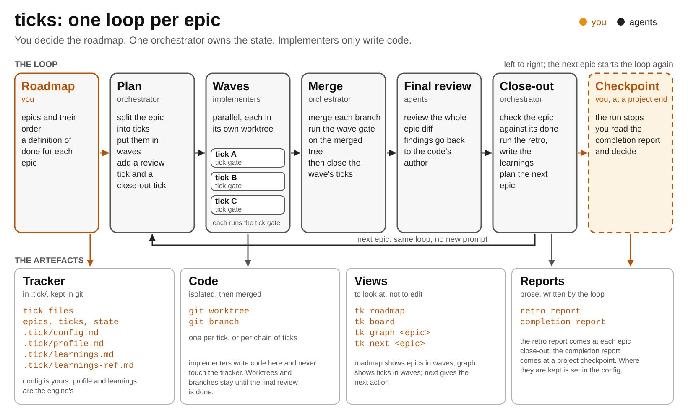

# ticks

The engine for planned work with AI agents. You write down what you want as an **epic**. The skill splits it into small **ticks** (tasks), runs them as parallel agents in their own git worktrees, checks each tick and each wave of ticks, reviews the whole result, and writes down what it learned. The tracker is the `tk` command-line tool; its state is a folder of files in your repository, so a run can stop and resume at any time.

**When not to use it.** Ticks is for work that spans sessions, has dependencies, or needs a human to approve something. For a small job that you finish in one conversation, use a plain todo list (for example Claude's TodoWrite) and do not create ticks. Do not create a tick for every small thing.

## Commands

The skill has no slash command. You ask in plain words ("create ticks for this", "plan this", "run the epic") and the agent uses `tk`. These are the `tk` commands you meet in daily use:

| Command | What it does |
|---|---|
| `tk init` | Set up `.tick/` in the repository (once) |
| `tk create "Title" ...` | Make a tick; `-t epic` makes an epic, `--parent` puts it under an epic, `--acceptance` says how to verify it |
| `tk list` / `tk ready` / `tk blocked` | See open ticks, ticks that can start, ticks that wait |
| `tk graph <epic>` | Show the waves of ticks and how many can run in parallel |
| `tk next <epic>` | The next thing to do: implement, plan, or wait for a human |
| `tk show <id>` | Show one tick |
| `tk note <id> "text"` | Add a note (use `--from human` for your own words) |
| `tk close <id> --reason "..."` | Close a tick; always give a reason |
| `tk list --awaiting=` | Ticks that wait for you |
| `tk approve <id>` / `tk reject <id> "why"` | Answer a tick that waits for approval |
| `tk board` | Web board to watch progress |
| `tk roadmap` | Epics in order, with what blocks what |

The usual order:

1. `tk init` once, and keep `.tick/` in git.
2. Describe the work. The agent asks what is unclear, then runs `tk create` for the epic and its ticks. Every epic gets a definition of done (`--acceptance`).
3. Check the plan with `tk graph <epic>`. Do any tasks that only a human can do (`tk list --awaiting work`).
4. Run the epic from your agent session. Waves run one after another; the ticks inside a wave run in parallel.
5. Answer what waits for you (`tk approve`, `tk reject`, `tk note`).
6. At the end the close-out checks the epic against its definition of done and plans the next epic.

## The picture



*Read it left to right: who acts is named under each box (you, the orchestrator, implementers, agents); the next epic starts the loop again.*

You set the roadmap: the epics, their order, and a definition of done for each. The orchestrator (the agent that owns the state) plans the epic into ticks and groups them into waves, with a final-review tick and a close-out tick at the end. In each wave, implementers work in parallel, one worktree each, and each passes the tick gate. The orchestrator then merges the branches, runs the wave gate on the merged tree, and only then closes the wave's ticks. Agents review the whole epic diff, and the close-out checks the epic against its done, runs the retro, and plans the next epic. At the end of a project the run stops for you at a checkpoint.

## Fuller documentation

### Set-up

```bash
# the tk binary, from upstream
curl -fsSL https://raw.githubusercontent.com/pengelbrecht/ticks/main/install.sh | sh

# in your repository
tk init
```

Copy or install this folder as a skill (see the repository's main README). Do not install upstream's own `ticks` skill next to it, and do not run `tk skills install`: that writes upstream's tracker-only skill into `.claude/skills/ticks/`, and it can run instead of this one.

The skill is generic; each project adapts it locally. The files under `.tick/` are your project's own: you may and should edit them, and updating the skill never overwrites them.

### The files in `.tick/`

Keep `.tick/` tracked by git, not in `.gitignore`: it syncs across machines and people by normal git. `tk init` writes `.tick/.gitignore`, which ignores only `.index.json` and `logs/`.

| File | What it is | Who writes it |
|---|---|---|
| ticks (one file each) | Every tick and epic, with notes and history | `tk` |
| `config.md` | Your project's guidance for runs (below) | you |
| `learnings.md` | Short always-read head: hard rules and an index (at most 4096 bytes) | the runner, at retro |
| `learnings-ref.md` | The longer body of learnings, by category | the runner, at retro |
| `profile.md` | How a fresh worktree is made runnable and where each test tier runs | the runner; never by hand |
| `.index.json`, `logs/` | Local caches and logs; not committed | `tk` |

### `.tick/config.md`

Optional. Each `##` section is wired to one consumer at one moment, so write only the sections you need and keep them short. An unknown heading is ignored, so a typo is silent. The runner reads the file fresh each time it needs it. Without the file, implementers find the test commands themselves.

| Section | Used by | When |
|---|---|---|
| `## Testing` | implementers, and the orchestrator | tick gate per tick; wave gate once per wave |
| `## Environment` | orchestrator | before wave 1: commands that check tools and services are ready |
| `## Rules` | every implementer | pasted into each implementer prompt; keep it short |
| `## At wave end` | orchestrator | after each wave gate passes |
| `## Closeout Evidence Commands` | orchestrator | at close-out only; fails closed |
| `## Acceptance Evidence` | orchestrator | at close-out; allows acceptance checks; fails closed |
| `## At epic close-out` | orchestrator | in the epic retro |
| `## At project checkpoint` | orchestrator | when a run stops at a project end |

### What it never does

Implementers only write code in their worktrees; they never change tick state. The orchestrator owns all tick state. Adding, removing or reordering epics in the roadmap is a human decision: the agent may propose it, not do it. Dates never block execution.

### References

- [references/tk-commands.md](references/tk-commands.md): every `tk` command and flag
- [references/tick-patterns.md](references/tick-patterns.md): how to write good ticks, and the Definition of Ready
- [references/big-picture.md](references/big-picture.md): projects, buckets, dates, and other opt-in structure
- [references/agent-runner.md](references/agent-runner.md): the shared run protocol (waves, gates, review, retro, learnings)
- [references/claude-runner.md](references/claude-runner.md) and [references/codex-runner.md](references/codex-runner.md): the adapters for Claude Code and Codex
- [references/code-smells.md](references/code-smells.md): the maintainability baseline for reviews

### Credit and license

This skill began as the skill in [pengelbrecht/ticks](https://github.com/pengelbrecht/ticks) (MIT, Peter Engelbrecht) and moved here with its history. Upstream's own skill is now tracker-only. The `tk` binary comes from upstream. License: [LICENSE](LICENSE) (MIT; it keeps Peter Engelbrecht's copyright).
